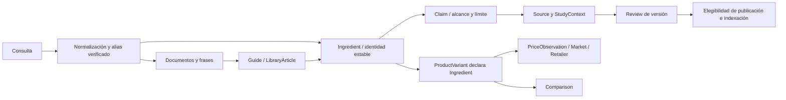

# PEPTIVELO — Master Audit and Roadmap

Auditoría: 21 de octubre de 2026, America/Lima. Snapshot UTC: 2026-10-22T03:04:44.554Z. Código base: `80fa15e`. Sitio: https://peptivelo.com. Solo documentación; sin cambios de producción, base de datos, infraestructura ni despliegue.

## A. Executive Summary

Seguimiento posterior: [publicación de beta y búsqueda conectada](PEPTIVELO_BETA_RELEASE.md). Este documento conserva el diagnóstico original del commit 80fa15e; los cambios posteriores y sus verificaciones se documentan por separado.

Peptivelo ya es un MVP funcional de conocimiento y comparación, no una maqueta: búsqueda documental, catálogo, fichas, comparador, guías con citas, lectura por niveles, identificación y calculadora están desplegados. El mayor salto de utilidad no requiere otro hero ni reconstruir el backend: requiere completar confianza pública, convertir relaciones existentes en recuperación útil y normalizar la revisión editorial.

**Cinco decisiones prioritarias:**

1. Mantener la beta sin indexación y completar identidad/contacto/privacidad, derechos de imágenes y gobierno de publicación antes de difusión amplia. El sitio es público aunque sea noindex.
2. Resolver identidad y relevancia de búsqueda con selectores y aliases verificables sobre JSON/Zod; no contratar RAG, vector DB, auth o CMS para resolver un catálogo de 12 productos contando haircare.
3. Conservar la arquitectura de comparación de tres niveles que ya existe; subir el resumen y estabilizar tipografía móvil, sin quitar citas ni inventar eficacia.
4. Priorizar el recurso de marca de 802KB y CLS reproducible antes de efectos visuales. Distinguir laboratorio de rendimiento real de usuarios.
5. Añadir gobierno de release, métricas de éxito y revalidación antes de expansión internacional/visión. La conexión GitHub funciona; el pipeline no es todavía una garantía de pruebas y revisión.

**Dictamen:** apto para beta técnica observada, con condiciones de confianza pendientes; no declarar lanzamiento editorial/comercial definitivo ni habilitar indexación masiva. No se ha demostrado una intrusión, una vulnerabilidad remota explotada, eficacia comparativa, revisión clínica ni conformidad legal/WCAG completa.

## B. Current State Audit

| Capa | Implementación comprobada | Límite |
| --- | --- | --- |
| Framework | next 16.4.2; react 19.3.1; vinext 1.2.1; @vinext/cloudflare 1.1.1; @cloudflare/vite-plugin 2.0.0-beta.v.2; vite 8.3.0; cf 1.0.0-beta.18; typescript 6.0.3; @playwright/test 1.64.1; @prisma/client 7.10.1 | Next baseline + vinext sobre Workers; cf/plugin beta. No es Pages estático. |
| Frontend | App Router, RSC/SSR, componentes React cliente para herramientas; catch-all src/app/[...slug]/page.tsx y rutas específicas | Catch-all extenso mezcla metadata/resolución/render de muchas entidades. Extraer selectores gradualmente, no reescribir rutas. |
| Backend | Render server-side y validación de JSON versionado; binding ASSETS | No API route pública, ingestión, cuentas, pagos o CRUD remoto encontrados. No requiere login para las funciones actuales. |
| Datos | Zod comprueba IDs y referencias en import; 11 productos,21 ingredientes, 8 marcas, 10 precios, 10 comparaciones | Haircare separado: 1 producto, 2 ingredientes. Fuentes 34 / notas 30. Sin Market/Variant explícitos ni review ledger activo. |
| Base de datos | Prisma 7.10.1 y esquema PostgreSQL con Compound/ProductIngredient/Review reservados | No runtime PrismaClient importado, binding DB o evidencia de conexión/migraciones en producción; no confundir esquema con backend conectado. |
| Búsqueda | Índice local tipado, 4 grupos, normalización, ranking, 7 sugerencias y resultados SSR | Sin typo real, facetas, índices de estudio ni expansión de entidades. GHK-Cu solo 1 resultado. |
| Internacionalización | en-US, USD, US fl oz; datos comerciales US | Sin i18n ni cobertura internacional. País, idioma y moneda no equivalen. |
| Diseño | Manrope/Inter locales, tokens light/dark, Lucide, modales/disclosures/tablas | globals.css y overrides acumulan reglas; comentarios históricos DM Sans no reflejan la fuente final. No cambiar el isotipo. |
| Servicios externos | Cloudflare Workers/GitHub Builds; enlaces externos documentales | Sin transporte de analytics ni visión remota. Logs hosting sí existen. Configuración privada no totalmente accesible. |
| Pruebas | 56 unitarias pasan; batería Playwright existente; 92 estados auditados en producción | No equivalen a revisión humana de cada afirmación, lector de pantalla real o ensayo con usuarios. |
| Despliegue | GitHub main → npm run build:vinext → npx cf deploy --prebuilt; último relanzamiento 80fa15e | Sin workflow de pruebas versionado y sin verificación privada de branch protection/rollback/retención. |

## Evidencias y alcance de verificación

- [Censo completo de rutas](audit-evidence/routes.md) y [respuestas HTTP/SSR](audit-evidence/route-audit.json): 70 URLs HTML sin parámetros, 3 variantes de query, robots, sitemap y 1 URL negativa; 75 respuestas 200 y el 404 esperado.
- [Inventario de datos](audit-evidence/data-inventory.json) y [versiones/activos](audit-evidence/technical-inventory.json).
- [92 estados de navegador](audit-evidence/browser-audit.json): 23 plantillas/rutas representativas × escritorio/móvil × claro/oscuro. Casos de datos individuales se censan por HTTP y fuente; no se afirma haber usado cada combinación posible de productos.
- [Revisión focalizada de red y filtro](audit-evidence/focused-browser-checks.json), [muestreo de cache/robots](audit-evidence/network-samples.json).
- [Tres cargas frías por ruta](audit-evidence/performance-followup.json) y [aislamiento de fuentes](audit-evidence/font-isolation.json). No hay Lighthouse, CrUX, RUM o INP p75 ejecutados/disponibles.
- [56 pruebas unitarias](audit-evidence/unit-tests-current.txt). [npm audit con respuesta completa](audit-evidence/npm-audit-bounded.json); un intento previo de red agotó timeout, por eso no se usa como diagnóstico de dependencias.
- Código y UI sí comprobados; credenciales de Search Console, facturación, branch protection, logs/retención privados, autorizaciones fotográficas y cualificación de revisores: **pendientes de verificación**. No hay examen jurídico ni nueva revisión clínica de los estudios.

Los resultados son una fotografía temporal del commit indicado. Noindex permite rastreo y no es control de acceso. Un status published de etiqueta no equivale a revisión científica. Los hallazgos propuestos se distinguen de fallos confirmados; no se ejecutan fixes en esta fase.

## C. Page-by-Page Findings

| Área | Rutas | Estado | Observado | Acción |
| --- | --- | --- | --- | --- |
| Homepage | / | Funcional con limitaciones | Hero/buscador/preview reales; después se repite catálogo completo y varios CTA de herramientas. Mensaje comprensible en evaluación heurística; comprensión en cinco segundos no medida con usuarios. | Conservar hero; priorizar confianza, búsqueda y bytes antes de otro rediseño; PV-001/006/013/016. |
| Universal search | /search/ y parámetros | Funcional con limitaciones | Combobox, grupos y resultados reales; GHK-Cu→1 ingrediente; sin expansión de relaciones, typo normalizado o facetas. | PV-006/007/019; no chatbot por defecto. |
| Skincare hub | /skincare/ | Funcional con limitaciones | Lista los 11 productos y repite entradas del Home; target-size aislado en metodología. | PV-014; definir si el hub tiene una tarea distinta antes de retirar rutas. |
| Product explorer | /skincare/products/ | Funcional con limitaciones | Seis filtros, búsqueda y reset; NIOD devuelve 1. Sin orden ni URL para todos los filtros. | PV-015; conservar filtro de precio disponible y estados vacíos. |
| Product detail ×11 | /skincare/products/[slug]/ | Funcional con limitaciones | Tamaño, etiqueta parcial, fecha, fuente, precio y comparaciones. No INCI completo. Choose a comparison preselecciona otro producto arbitrario. P-TIOX mezcla contexto regional con aviso. | PV-010/016; no inferir concentración/eficacia; conservar precio ausente de COSRX. |
| Ingredients index ×1 | /skincare/ingredients/ | Funcional | 21 fichas enlazadas; carece de búsqueda/facetas propias, no urgente con volumen actual. | Conservar; integrar navegación desde búsqueda universal, PV-006. |
| Ingredient detail ×21 | /skincare/ingredients/[slug]/ | Funcional con limitaciones | Identidad, educación, límites, fuentes y lista inversa de productos existen. Ausencia de bandera no prueba revisión; no hay registro estructurado de aliases. | PV-003/006/009; no proponer crear desde cero el vínculo con productos. |
| Interactive comparator | /skincare/compare/ y a, b | Funcional con limitaciones | Selección visual, hechos comparables, unit prices, unknowns, fuentes y URLs. Solo catálogo facial; no ranking de eficacia. | PV-011/016; evaluar tarea de seleccionar segundo producto y comprensión de cantidades. |
| Editorial comparisons ×10 | /skincare/compare/[slug]/ | Funcional, contenido draft | Tres pestañas y respuestas/documentación ya implementadas. Siete modos label y tres research tras default; texto móvil empieza por tarjetas. | PV-003/009/011/012; conservar todas las referencias. |
| Question-led entry | /skincare/choose/ | Funcional con limitaciones | Selección por pregunta usa comparaciones disponibles, no motor diagnóstico. | Conservar como recorrido para principiantes; enlazar contexto y verificar cobertura al crecer. |
| Guides index +2 | /skincare/guides/ y [slug] | Funcional, contenido draft | Guías porcentajes y Matrixyl, citas y ejemplos explícitos. Solo dos; no autoría aprobada. | PV-017; mejorar estas antes de ampliar cientos. |
| Peptide library index | /library/ | Funcional con limitaciones | Puerta a cosmética, categorías y haircare; tres artículos, no enciclopedia de péptidos exhaustiva. | Mostrar alcance/piloto y crear entrada cosmética básica; PV-017. |
| Library briefs ×3 | /library/peptide-categories/, /retatrutide/, /bpc-157/ | Funcional, contenido draft | Separan contexto experimental/medicinal/cosmético y advierten review pending. La fecha de comprobación se codifica en el componente. | PV-003/009/017; sin protocolos terapéuticos ni equivalencia regulatoria global. |
| Identification | /skincare/identify/ | Funcional con limitaciones | Búsqueda manual, selección y confirmación exacta; no autentica lote/envase. Scanner resuelve QR propios; lista GTIN vacía. | PV-022; wording debe distinguir lectura de códigos de cobertura barcode real. |
| Price calculator | /tools/price-per-ml/ | Funcional con limitaciones | 2–6 filas, USD, mL/US fl oz, validación, porcentaje y URL compartible; no importa ofertas ni convierte monedas. | Conservar; conectar datos solo después de variante/mercado; PV-018. |
| Hair & scalp ×4 | /haircare/, producto y 2 ingredientes | Piloto funcional | 1 producto y 2 ingredientes separados del catálogo facial; draft/noindex y límites claros. | PV-008; no presentar como cobertura completa ni forzar comparación facial. |
| Methodology | /methodology/ | Funcional con límites editoriales | Procedimiento de fuentes, precios, incertidumbre, conflicto y review. Predomina prosa; política no equivale a workflow ejecutado. | PV-003/009/017 para workflow y revalidación. |
| Sources | /sources/ | Funcional con limitaciones | 34 fuentes agrupadas a nivel muy amplio; detailed evidence notes cubren30. No buscador independiente de estudios. | PV-009; faceta por tipo/entidad solo cuando mejora tareas reales. |
| About | /about/ | Parcialmente implementada | Texto de operador pendiente en producción. | PV-001, bloqueo de confianza. |
| Contact & corrections | /contact/ | Parcialmente implementada | Instrucciones de corrección, pero sin canal configurado. Corrections no tiene página propia; se agrupa aquí. | PV-001; no exigir nueva URL solo por nombre. |
| Privacy | /privacy/ | Parcialmente implementada | Describe hosting no seleccionado pese a Cloudflare activo; logs, identidad/retención/contacto pendientes. | PV-001; cotejar configuración real antes de declarar política definitiva. |
| Terms | /terms/ | Provisional | Limitaciones y scope explícitos; el texto declara términos MVP preliminares y falta jurisdicción. | PV-001; revisión del propietario/asesoría. |
| Editorial policy | /editorial-policy/ | Política presente, operación parcial | Independencia y criterios claros; sin evidencias de aprobaciones, autores/revisores en cada versión. | PV-003/017. |
| Affiliate disclosure | /affiliate-disclosure/ | Funcional, declaración por verificar operacionalmente | Declara ausencia de acuerdos; URLs actuales van a fabricantes y affiliateUrl nulo. No hay pipeline de monetización activo. | No anunciar partners ni añadir SDK. Revalidar cuando cambie la relación. |
| Robots/sitemap/404 | /robots.txt, /sitemap.xml y URL negativa | Funcional en beta | Sitemap vacío por gate; robots permite leer noindex; URL desconocida responde404. | PV-020 después de gobernanza; no desbloquear Google ahora. |

El detalle visual/componente está en [UI/UX Audit](PEPTIVELO_UI_UX_AUDIT.md). Cada URL concreta aparece en [routes.md](audit-evidence/routes.md); incluye los 11 productos,21 ingredientes,10 comparaciones,2 guías,3 artículos y el piloto haircare. No se declara una plantilla revisada como si cada estudio estuviera validado clínicamente.

## D. Root Cause Analysis

| Causa raíz | Hecho | Evitar diagnóstico equivocado | Iniciativas |
| --- | --- | --- | --- |
| Información externa | Faltan operador/contacto/permiso de fotos | Un nuevo componente no puede suministrar identidad o licencia | PV-001/002 |
| Modelo editorial | Boolean opcional, drafts y fechas repartidas | No llamar reviewed a los12 registros sin bandera | PV-003/009/017 |
| Búsqueda | Matching textual permite tokens genéricos y no recorre IDs | No falta toda relación producto-ingrediente: ya existe y la ficha la usa | PV-006/007 |
| Datos regionales | Subset UK de P-TIOX bajo encabezado US | No asumir fórmula US igual ni defecto de eficacia | PV-010 |
| UX de lectura | Resumen existente pero bajo tarjetas en móvil | No reconstruir tres niveles ya implementados | PV-011/016 |
| Performance | Logo802223B; cambios de métricas de fuentes/breadcrumbs | Un screenshot final bonito no prueba ausencia de CLS | PV-012/013 |
| Integración | Build desplegable sin tests obligatorios; eventos solo locales | Buildsuccess y clics no validan calidad editorial ni conversión | PV-005/019 |
| SEO intencional | Noindex global, sitemap vacío | No es un fallo urgente de indexación; conservar gate | PV-020 |
| Seguridad | Dependencias marcadas y cabeceras ausentes | Ocho nodos high no son ocho fallos remotos confirmados | PV-004/021 |

## E. Proposed Architecture

Reutilizar IDs y validadores actuales. Añadir selectores comunes de documentos, variantes, relaciones y elegibilidad. Mantener JSON como persistencia inicial; Prisma es una opción posterior si edición concurrente, historial o ingestión lo justifican. No crear un segundo grafo manual paralelo sin derivación/validación.

La arista “declara ingrediente” no significa “fue estudiado” ni “tiene el mismo resultado”. Compound/Peptide solo debe añadirse cuando ayude a distinguir identidades: no fusionar nomenclaturas por semejanza textual. [Diseño detallado](PEPTIVELO_SEARCH_ARCHITECTURE.md).

## F. Design System Improvements

Conservar paleta, logo, tipografía, hero search-first, controles de tema, modales nativos, estados vacíos, Source/Citations y las tres pestañas del lector. Consolidar gradualmente SearchField, FieldLabel, DocumentResult, Disclosure, EvidenceSummary, PriceObservation, EditorialStatus y Breadcrumbs; diferenciar artículo/ingrediente/producto con contenido y densidad, no tarjetas idénticas.

Refactorizar el orden y especificidad de estilos por componente después de capturar regresiones. No reescribir globals.css entero ni cambiar rutas al mismo tiempo que fuentes, datos y búsqueda. Corregir primero el enlace táctil y las métricas de fuentes. SourceKind debe seguir siendo texto neutral, nunca color/rating de eficacia.

## G. Product & Content Improvements

Completar identidad y permisos; fuente/variante por campo; review ledger de versiones; aliases documentados; fuentes con contextos de estudio; fechas de revalidación; preguntas cosméticas fundamentales; un único piloto haircare explícito. Todos los productos tienen subset INCI, no lista completa; eso es una limitación reconocida y no debe ocultarse. COSRX no tiene precio de 50 mL y debe seguir mostrándose como no registrado hasta obtenerlo. Los precios del 18–20 de octubre no se declaran vencidos a fecha 21 de octubre.

El principiante necesita una entrada a qué es un péptido; el investigador, una vista de fuente/preparación; el comparador, síntesis verificable; el comprador, precio/fecha/variante. No obligar a completar un funnel común ni exigir registro.

## H. Prioritized Roadmap

P0 significa condición previa para difusión/lanzamiento responsable o triage de riesgo; no todos son incidentes de seguridad. P1 utilidad/UX directa, P2 consistencia/crecimiento, P3 hipótesis con datos externos. Esfuerzo: S=un cambio acotado; M=varios componentes actuales; L=modelos/contenido/transiciones con pruebas; XL=servicio o nueva cobertura operativa. No son plazos ni compromisos: una autorización externa puede dominar cualquier tamaño.

| ID | Problema | Evidencia | Impacto | Prioridad | Solución | Dependencias | Esfuerzo | Criterio de aceptación |
| --- | --- | --- | --- | --- | --- | --- | --- | --- |
| PV-001 | Publicar operador, contacto y política real de tratamiento de datos | HTTP 200 y texto provisional en /about/, /contact/, /privacy/; src/lib/pages.ts y src/lib/config.ts. Cloudflare ya procesa solicitudes. | Condición previa de difusión/lanzamiento | P0 | Obtener los datos del propietario, configurar identidad y contacto, identificar Cloudflare y documentar finalidad/retención/acceso a logs; revisar términos y jurisdicción con asesoría apropiada. No inventar información ni publicar un correo ficticio. | Propietario: identidad pública, correo funcional, jurisdicción; política operativa de logs; revisión legal cuando corresponda. | M | About identifica al responsable; Contact permite una corrección real y entrega comprobada; Privacy describe el hosting existente y retención aprobada; Terms deja de presentarse como texto provisional. Responsable aprueba la información. |
| PV-002 | Resolver derechos de las fotografías publicadas | public/images/products/SOURCES.md; 11 imágenes de skincare y 1 de haircare visibles. Procedencia y crédito no equivalen a licencia. | Condición previa de difusión/lanzamiento | P0 | Crear un registro de permisos por activo o sustituirlo por fotografía propia/autorizada del tamaño exacto. Conservar la identidad del producto y su procedencia; aprobación del propietario antes de difusión amplia. | Respuesta de titulares o activos propios; revisión legal de los usos previstos. | L | Cada activo público tiene licencia/permiso/autoría documentados y alcance compatible, o se retira/sustituye; las dimensiones y variantes siguen coincidiendo con la ficha. |
| PV-003 | Hacer explícita y restrictiva la elegibilidad de revisión e indexación | src/lib/data.ts education.scientificReviewPending optional; src/app/[...slug]/page.tsx usa !flag; src/app/sitemap.ts usa !flag. No se verificó un historial de aprobación humana. | Condición previa de difusión/lanzamiento | P0 | Separar revisión documental de revisión científica y publicación. Añadir estados explícitos y registro de reviewer/date/contentVersion/decision. Elegibilidad centralizada que falle cerrada cuando falten datos. Mantener noindex hasta pasar las dependencias de lanzamiento. | PV-001; responsable editorial; criterios de revisión y evidencias humanas reales. | L | Ningún estado ausente implica revisión; una ficha de etiqueta puede tener verificación documental sin certificación clínica; un borrador no entra en sitemap ni pierde noindex al activar SITE_INDEXABLE; una aprobación queda vinculada a versión concreta. |
| PV-004 | Evaluar y mitigar la cadena de dependencias marcada por npm audit | audit-evidence/npm-audit-bounded.json; Vite 8.3.0, braces advisory GHSA-vfj7-8cjw-p6xm; Vite GHSA-9jrq-w75r-8gcw y familia launch-editor. La salida propone un parche Vite compatible y degradaciones mayores antiguas para vinext. | Condición previa de difusión/lanzamiento | P0 | Trazar uso build/dev/runtime; probar la actualización Vite compatible indicada en rama aislada y evaluar upstream de braces. No ejecutar audit fix --force ni degradar vinext a 0.0.15 por automatismo. Registrar mitigaciones y cualquier excepción con responsable y caducidad. | Compatibilidad de vinext/plugin cf; documentación upstream de cada aviso. | M | Inventario de avisos con alcance y decisión; parche compatible validado o excepción razonada; no se expone servidor Vite de desarrollo como producción; builds y recorridos pasan. |
| PV-005 | Añadir una puerta de calidad antes de desplegar main | package.json build:vinext; docs/CLOUDFLARE_DEPLOYMENT.md; ausencia de workflow en repositorio. El build 80fa15e terminó con éxito tras reconectar GitHub. | Utilidad/confianza/experiencia directa | P1 | Versionar una secuencia lint → tipos → unitarias → Worker build → smoke de staging. Incluir las rutas universales y revisiones en la política. Documentar reconexión Git y rollback a una versión concreta. | PV-004; acceso del propietario a permisos/branch protection/Cloudflare. Su configuración privada actual queda pendiente de verificar. | M | Un fallo intencional bloquea publicación; logs identifican commit; existe procedimiento de rollback ensayado en staging; secretos se configuran fuera del repositorio. |
| PV-006 | Expandir identidades verificadas hacia documentos relacionados en la búsqueda | Consulta de producción GHK-Cu: 1 resultado. src/lib/search-index.ts solo añade el alias a un documento; catalog.products[].ingredientIds y comparisons[].comparedProductIds ya existen. | Utilidad/confianza/experiencia directa | P1 | Resolver alias verificado a ingredientId estable, recuperar documentos directos y expandir un salto a productos y comparaciones; mostrar por qué coincide cada resultado. Agregar estudios solo cuando se registre una relación respaldada; no inferir equivalencia química. | PV-003; tabla de alias documentados; conservar IDs/URLs existentes. | L | GHK-Cu y una variante ortográfica aprobada devuelven el ingrediente y los productos que declaran ese ID, con explicación; Tripeptide-1 Copper Acetate no se fusiona automáticamente; las relaciones sin fuente no aparecen como verificadas. |
| PV-007 | Corregir relevancia de consultas compuestas y tolerancia a errores | audit-evidence/browser-audit.json queries; src/lib/search.ts usa ceil(tokens.length/2), prefix y pesos de título. La pregunta sobre 10% también devuelve 44 documentos. | Utilidad/confianza/experiencia directa | P1 | Introducir consultas normalizadas por entidad/frase, peso bajo para palabras genéricas y coincidencias relacionadas separadas de exactas. Tolerancia tipográfica limitada sobre vocabulario existente con sugerencia visible, sin sustituir nombres científicos silenciosamente. | PV-006 para aliases y entidades; evaluación de consultas con el editor. | M | Corpus aprobado de al menos 30 consultas con negativos; primer resultado útil esperado; productos sin identidad consultada no se presentan como coincidencia exacta; correcciones propuestas se anuncian y se pueden ignorar. |
| PV-008 | Unificar selectores de datos entre skincare y haircare sin mezclar ámbitos | src/lib/haircare.ts; src/data/haircare.json; src/lib/search-index.ts; src/components/product-identify.tsx; catálogo facial de 11 y piloto de 1 scalp serum. | Consistencia y capacidad de crecimiento | P2 | Crear interfaces comunes de documento, producto y observación con scope/category explícitos; adaptar haircare antes de migrar datos. Mantener comparaciones compatibles y un mensaje de cobertura piloto. | PV-010; revisión editorial de reglas de elegibilidad. | L | Una identidad/fecha/fuente se mantiene una vez; búsqueda indica scope; el comparador facial no admite scalp por accidente; todos los slugs actuales siguen resolviendo. |
| PV-009 | Conectar afirmaciones y preparaciones estudiadas a las fuentes existentes | 34 Source; 30 EvidenceNote; faltan pubchem-29, lubrizol-uplevity, lubrizol-formulation, fda-cosmetic-reactions. src/lib/citations.ts y src/lib/study-data.ts. | Utilidad/confianza/experiencia directa | P1 | Extender los modelos existentes con entidad/preparación estudiada, claimId, limitación y estado de acceso/revisión. Normalizar datos de estudio solo cuando estén disponibles y conservar narrative original. Completar notas apropiadas para las cuatro fuentes; no exigir DOI a organismos o etiquetas. | PV-003; trabajo documental y revisión cualificada. | L | Afirmación relevante navega a fuente, alcance, preparación y límite; estudio de ingrediente no se etiqueta como ensayo del retail; financiación y acceso distinguen declarado/no extraído/no aplica; no hay citas rotas. |
| PV-010 | Modelar variante y mercado por dato de etiqueta, no por supuesto global | catalog.json skinceuticals-ptiox.ingredientListScope; src/lib/search-index.ts detail US label profile; src/app/[...slug]/page.tsx h2 US label. 0/11 INCI completos estructurados. | Utilidad/confianza/experiencia directa | P1 | Añadir variant/market/formulaVersion y provenance por campo/selección, con estado verified/partial/not_recorded. Mostrar la fuente UK junto a los ingredientes y evitar presentar su coincidencia US como comprobada. Mantener la lista seleccionada como tal. | Fuentes de variante exacta; PV-009 para vínculos de evidencias. | L | P-TIOX distingue mercado de precio e ingrediente; todos los productos explicitan si el INCI es completo o seleccionado; una región desconocida no se transforma en US; ninguna concentración se infiere por orden. |
| PV-011 | Hacer visible el resumen de comparación sin eliminar los tres niveles actuales | src/components/editorial-comparison.tsx; src/components/reader-tabs.tsx; screenshot 08-mobile-light.png; 5.189 palabras de contenido completo frente a unas 379 visibles en esa muestra. | Utilidad/confianza/experiencia directa | P1 | Subir una síntesis documental del par antes o junto a sus tarjetas y compactar presentación móvil; conservar las pestañas, citas y disclosures. Distinguir lector editorial de comparador dinámico. | PV-009; aprobación editorial del resumen; PV-012 para estabilidad. | M | Usuario distingue dato y limitación en la primera sección; los tres niveles siguen accesibles con teclado/no-JS; todas las citas y retorno al par se conservan; no aparecen ganadores de eficacia. |
| PV-012 | Estabilizar fuentes y breadcrumbs en lectores móviles | audit-evidence/performance-followup.json y font-isolation.json; src/app/brand-typography.css font-display swap; screenshots/08-mobile-light.png. | Utilidad/confianza/experiencia directa | P1 | Medir y ajustar métricas de fallback, preload selectivo de las fuentes críticas y geometría estable de breadcrumb/encabezado. Conservar texto visible y fuentes aprobadas; no cambiar a font-display block para esconder el problema. | PV-013 para liberar descarga prioritaria; perfil de red reproducible. | M | Tres cargas frías móviles por página clave con CLS ≤0,1 en laboratorio y sin texto invisible; no aparece salto de línea tardío; registrar antes/después y métricas de campo cuando existan. |
| PV-013 | Entregar una variante ligera del isotipo conservando el original aprobado | audit-evidence/focused-browser-checks.json: encodedBodySize 802223, duración observada ~945ms; original asset y src/components/brand-identity.tsx. No se ha medido aún el ahorro de una variante nueva. | Utilidad/confianza/experiencia directa | P1 | Crear tamaños raster optimizados para header/favicon a partir del arte aprobado, sin rediseñarlo ni inventar SVG. Conservar master; fijar dimensiones; usar rutas versionadas y comprobar el comportamiento de vinext. | Permiso para derivar el activo de marca existente; PV-005 para smoke de assets. | S | Recurso de header ≤20KB de presupuesto inicial o excepción justificada con calidad visual; 44px y retina legibles; la red confirma la variante pequeña, no una redirección al PNG de 802KB. |
| PV-014 | Corregir el objetivo táctil de metodología en el hub skincare | browser-audit.json: cuatro estados del mismo componente; selector p:nth-child(4) > a[href$="methodology/"]. WCAG 2.2 tag target-size. | Utilidad/confianza/experiencia directa | P1 | Aplicar área clicable/espacio suficiente al enlace aislado; mantener estilo editorial y foco visible. No declarar que todo enlace en línea pequeño es una infracción. | Ninguna; confirmar excepción de enlace inline en revisión manual. | S | Axe deja de señalar ese nodo, área/separación cumple el criterio aplicable y el enlace sigue claro en ambos temas y tamaños. |
| PV-015 | Hacer reproducibles los filtros del catálogo y aclarar sus etiquetas | src/components/interactive.tsx Explorer; focused-browser-checks.json: filtro NIOD devuelve 1 producto. El primer selector por etiqueta exacta falló en la prueba, pero por control real funcionó. | Consistencia y capacidad de crecimiento | P2 | Etiquetas explícitas htmlFor/id o nombre accesible conciso; serializar filtros validados en URL; añadir orden por nombre/precio unitario/fecha, con desconocidos siempre identificados. Mantener reset y feedback de resultados. | PV-010/PV-018 para ordenación comercial coherente. | M | Copiar/recargar URL conserva filtros; la opción NIOD devuelve 1; etiqueta se anuncia sin todo el catálogo; precio sin registro no se convierte en cero; orden estable. |
| PV-016 | Conservar contexto entre resultados, ingrediente y comparación | src/app/[...slug]/page.tsx returnPath y products.find(x=>x.id!==p.id); src/components/navigation.tsx; links y URL observados. | Utilidad/confianza/experiencia directa | P1 | Acceso compacto a búsqueda global en navegación sin añadir un menú grande; conservar q y par de origen con parámetros permitidos; desde producto iniciar selección con a=producto y permitir elegir b, sin contrincante arbitrario. | PV-006; reglas de URL/noindex; no cambiar slugs. | M | Puede hacerse SEARCH→ingrediente→producto→compare y volver a la búsqueda/par; el segundo producto requiere selección explícita o se identifica como ejemplo; no se pierde estado con Back. |
| PV-017 | Cubrir preguntas editoriales de entrada con autoría y revalidación | src/lib/library.ts; src/app/library/[slug]/page.tsx fija Sources checked October 20, 2026; guides.json; declaraciones de revisión pendiente. | Consistencia y capacidad de crecimiento | P2 | Priorizar glosario Qué es un péptido, lectura de INCI seleccionado/completo, porcentajes de mezcla y diferencias entre evidencia de ingrediente/formulación/producto; enriquecer 2 guías existentes antes de crear más. Publicar autoría real, revisión y fechas desde datos. | PV-001/PV-003/PV-009; disponibilidad de editores/revisores. | L | Cada nuevo contenido responde una pregunta validada, enlaza entidades/fuentes y tiene responsable; actualización real cambia versión/revalidación; no se generan páginas masivas ni se reutiliza fecha fija. |
| PV-018 | Normalizar observaciones comerciales y su vigencia | catalog.json prices; priceFor selecciona por tamaño y fecha; fechas 18–20 de octubre de 2026, no desactualizadas por antigüedad a la fecha de auditoría; src/lib/math.ts USD. | Consistencia y capacidad de crecimiento | P2 | Separar Market/Currency/Variant/Offer de PriceObservation con fuente, observado/verificado, impuestos/envío y disponibilidad histórica. Añadir estado de vigencia según política aprobada sin borrar la observación. Completar COSRX solo con evidencia exact-size. | PV-010; fuentes/vendedores; decisión editorial sobre caducidad. | L | No hay conversión implícita de moneda ni cheapest global; observación vencida sigue fechada y no se llama precio actual; cantidades/tamaños coinciden; stock observado no se presenta como stock actual. |
| PV-019 | Medir éxito de tareas con eventos mínimos y consentimiento apropiado | src/lib/analytics.ts; hero-search.tsx; interactive.tsx onChange; eventos existentes en comparación/calculadora/fichas. Sin SDK externo encontrado. | Utilidad/confianza/experiencia directa | P1 | Definir search_submitted/result_selected/no_results y relaciones de sesión efímeras, sin query médico/personal crudo; medir task_complete. Mantener interfaz local y añadir transporte solo tras decisión de privacidad; no exigir SDK comercial. | PV-001; objetivos de producto; datos de baseline antes de A/B. | M | Cada acción emite una vez con source/category/status y sin contenido sensible; consultas vacías distinguibles; existe forma de analizar éxito y no solo clics; política refleja el transporte real. |
| PV-020 | Preparar SEO editorial por elegibilidad, sin levantar noindex global todavía | 76 comprobaciones HTTP; canonical del dominio real; robots permite crawl y sitemap vacío; JSON-LD: Organization/WebSite + BreadcrumbList, sin Product/Offer vendedor. Search no tiene canonical pero es noindex. | Consistencia y capacidad de crecimiento | P2 | Después de PV-001/2/3, generar sitemap de elegibles y canonical consistente, examinar slash/http/https y parámetros; datos Article con autor real si procede, no inventar Review/AggregateRating/Offer. Conectar Search Console con autorización del dueño. | PV-001/PV-002/PV-003/PV-017; GSC y datos de propiedad. | M | Solo URLs aprobadas en sitemap e indexables; borradores/search/calculaciones parametrizadas siguen noindex; no localhost; breadcrumbs reflejan nombres reales; sin schema de vendedor falso. |
| PV-021 | Ajustar cache de assets y evaluar cabeceras de seguridad con alcance | network-samples.json; route-audit.json headers; src/proxy.ts; cloudflare.config.ts runWorkerFirst. Logs habilitados y query redaction configurado. | Consistencia y capacidad de crecimiento | P2 | Versionar assets y cachear immutable solo nombres con hash; conservar revalidación para archivos mutables. Evaluar CSP en report-only antes de enforcing, frame-ancestors y política de cámara propia; confirmar redacción/retención en configuración real. | PV-001/PV-005/PV-013; acceso Cloudflare; mapa de scripts inline y cámara. | M | Una actualización de logo/CSS no queda obsoleta; cache-control cumple estrategia de nombres; cabeceras no rompen RSC, tema ni escáner; política de logs probada con query sintético no sensible. |
| PV-022 | Ampliar mercados e identificación avanzada solo con datos y demanda | verifiedProductCodes=[]; haircare y skincare USD/US; ProductScanner decodifica códigos y resuelve enlaces locales. No servicio visual externo. | Hipótesis futura | P3 | Piloto de un mercado y un vendedor con fuentes/fechas; GTIN comprobados por variante; evaluar OCR/visión solo tras medir fallos manuales y obtener muestras autorizadas. Separar aprobación humana de hipótesis de imagen. | PV-001/PV-010/PV-018/PV-019; fuentes, permisos, presupuesto y cobertura; ninguna compra o alta automática en esta fase. | XL | Piloto con cobertura y límites visibles, precios/moneda correctos; barcode verificado lleva a variante exacta y pide confirmación; imagen incierta no identifica como hecho; privacidad y costes aprobados. |

## I. Implementation Phases

1. **Fase 0 — Confianza y control de release:** PV-001/002/003/004; iniciar instrumentación de PV-019 sin transporte externo hasta aprobar privacidad; preparar PV-005. Salida: responsables, permisos y riesgos documentados; noindex preservado.
2. **Fase 1 — Mejoras medibles de experiencia:** PV-013/014 y PV-012; estabilizar labels/componentes y retorno de PV-016. Salida: red/CLS/teclado verificables, sin rediseño general.
3. **Fase 2 — Descubrimiento conectado:** PV-006/007; corpus de consultas y facetas por necesidad. Salida: consultas equivalentes llevan a identidades/relaciones correctas y no a resultados masivos por palabras genéricas.
4. **Fase 3 — Fichas y evidencia:** PV-009/010/011, adaptación de PV-008. Salida: variantes y preparación estudiada explícitas; resumen y documentación preservados.
5. **Fase 4 — Contenido y datos:** PV-017/018/015. Salida: guías prioritarias revisadas, datos de oferta/fecha consistentes, filtros reproducibles.
6. **Fase 5 — SEO y expansión:** PV-020/021, completar transporte analítico si aprobado y evaluar PV-022 solo con demanda/fuentes. Salida: indexación selectiva, evidencia de éxito de tareas; ninguna expansión de países ficticia.

## J. Acceptance Criteria

Cada ticket tiene pruebas y condiciones en [Implementation Backlog](PEPTIVELO_IMPLEMENTATION_BACKLOG.md). Gates comunes: no enlaces rotos ni cambio de slugs, no XSS en texto/JSON-LD, cálculos correctos con valores extremos, separación precio/moneda/fecha, revisión no inferida, teclado/escape/retorno de foco, noindex de borradores, SSR útil y no-JS para lectura. La aceptación incluye qué no se sabe; no exige inventar datos para llenar campos.

Una prueba con 5–8 participantes iniciales debe comprobar: encontrar un significado, identificar una variante, entender qué prueba un estudio, comparar dos etiquetas y usar la calculadora. Registrar éxito sin ayuda, errores, retorno al contexto y confianza calibrada; no medir “menos lectura” como objetivo automático. Estos estudios de usuarios están propuestos, no ejecutados.

## K. Risks & Dependencies

Identidad/contacto/jurisdicción y derechos requieren al propietario; revisión científica requiere una persona cualificada con evidencia de aprobación; cobertura comercial requiere fuentes y fechas por región. Actualizaciones beta pueden romper RSC; JSON manual puede divergir; pipeline privado no auditado íntegramente. No hay datos de campo, SearchConsole o analítica productiva para atribuir mejora de conversión. No se ejecutaron pruebas ofensivas, pruebas médicas ni dictamen jurídico.

## L. Quick Wins

- PV-013: miniatura del logo conservando master; validar bytes reales.
- PV-014: área del enlace de metodología del hub.
- PV-001: datos institucionales reales una vez aportados, sin añadir backend de mensajes innecesario.
- PV-016: no preseleccionar un rival arbitrario desde producto.
- PV-015: label explícito de marca y URL de filtros antes de una interfaz de filtros nueva.
- PV-007: ampliar fixtures con falsos positivos actuales; no presentar tener resultados como éxito.

## M. Final Recommendation

La primera iniciativa debe ser **PV-001: cerrar confianza institucional de la beta pública**, coordinada con PV-002/003 y triage PV-004. Mientras se reciben datos externos, PV-013/014 ofrecen mejoras concretas pequeñas. La primera inversión de producto después de esos gates debe ser **PV-006+007**, no otro rediseño visual: conectar identidad, fuente, productos y comparación utilizando las relaciones ya presentes. No activar indexación todavía ni reescribir la plataforma.

### Benchmark funcional consultado

| Referencia primaria | Patrón observado | Problema Peptivelo / adaptación | Complejidad y beneficio |
| --- | --- | --- | --- |
| [INKEEDecoder](https://inkeedecoder.com/) — redirección actual de INCIDecoder | Entrada común a productos/ingredientes y decodificación de listas | Vocabulario compartido en resultados de identidad y producto, sin adoptar juicios de ingrediente | M; orientación inicial. No copiar ratings o claims. |
| [PubMed User Guide](https://pubmed.ncbi.nlm.nih.gov/help/) | Búsqueda por campos, vocabulario y filtros documentados | Etiquetas de source/study context y explicación de coincidencia; no fingir ser una revisión sistemática | M–L; trazabilidad y control de alcance. |
| [SkinSort Compare](https://skinsort.com/compare) | Selección de dos productos e ingredientes lado a lado | Conservar selector visual/par y diferencia de listas; no adoptar puntuación personalizada de eficacia | M; comparación comprensible sin convertir el sitio en tienda. |

Las páginas se consultaron como fuentes de patrones funcionales, no como validación clínica ni endorsement. No se usaron sus cifras comerciales para estimar demanda de Peptivelo. Para métricas: [Web Vitals](https://web.dev/articles/vitals); para alcance de dependencias, [braces advisory](https://github.com/advisories/GHSA-vfj7-8cjw-p6xm) y [Vite middleware advisory](https://github.com/advisories/GHSA-9jrq-w75r-8gcw).
