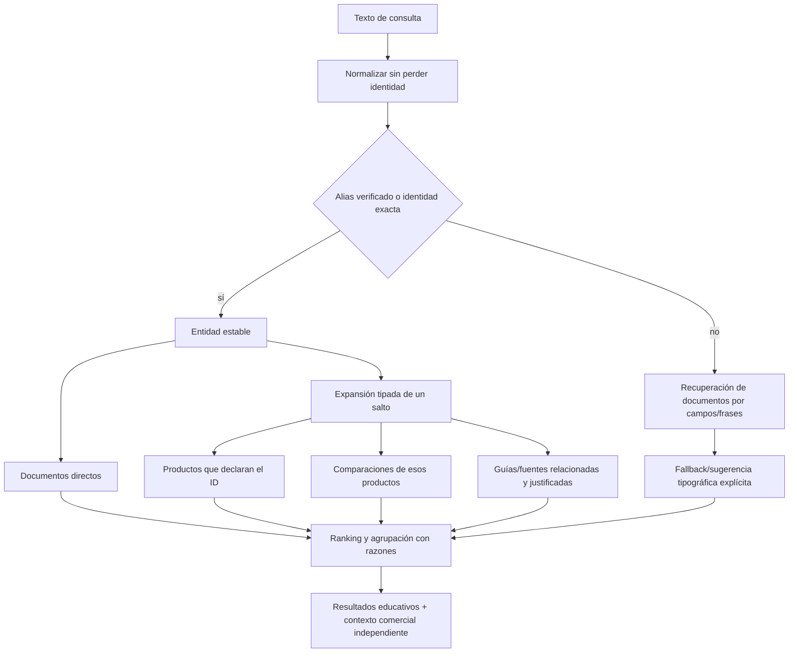

# Peptivelo — Search Architecture

Auditoría: 21 de octubre de 2026, America/Lima. Snapshot UTC: 2026-10-22T03:04:44.554Z. Código base: `80fa15e`. Sitio: https://peptivelo.com. Solo documentación; sin cambios de producción, base de datos, infraestructura ni despliegue.

## 1. Diagnóstico comprobado

Seguimiento: la [entrega de beta](PEPTIVELO_BETA_RELEASE.md) implementa después de esta auditoría identidades, expansión por relaciones, fuentes y precisión de consultas. Las cifras de 51 documentos y los fallos siguientes describen el snapshot original, no esa implementación posterior.

El motor actual **sí es universal para documentos del proyecto**, pero es lexical y plano, no una búsqueda de entidades/estudios. El índice se construye en src/lib/search-index.ts y pasa al HeroSearch cliente; el servidor usa la misma función para /search/. No hay servicio remoto, vector DB, persistencia de consultas ni API de generación de respuestas.

| Elemento | Código actual | Efecto |
| --- | --- | --- |
| Colecciones | 21 ingredientes skincare +2 haircare,11 productos skincare +1 haircare,2 guías,3 artículos, metodología,10 comparaciones | 51 documentos potenciales con los datos actuales; confirmar conteo por índice si cambian estados. |
| Nombre y términos | name/detail/terms/href/category | Alias GHK-Cu solo en Copper Tripeptide-1. sourceId/ingredientId/productId no forman parte de un documento recuperable relacional. |
| Normalización | minúsculas, NFKD, quitar acentos/puntuación; stopwords inglesas;prefijo;quitar s final | No typo distance ni mapa de variantes compacto. GHK-Cu se separa en ghk/cu; GHKCu queda unido. |
| Ranking | Título exacto/frase/tokens con peso; mínimo ceil(tokens/2) | Una palabra genérica satisface una consulta de dos términos; descartar copper todavía deja peptide suficiente. |
| Sugerencias | Un primer resultado por categoría disponible y luego hasta 2/grupo; máximo 7 | Buena diversidad; no corrige la calidad de cada coincidencia. |
| Resultados completos | Agrupación por 4 categorías, sin filtro de tipo; query en URL; noindex | No hay resultados de fuente/estudio como tipo propio ni navegación explicada por relación. |
| Accesibilidad | Combobox/listbox, active-descendant, arrows, Enter, Escape, status;Ctrl/Cmd+K en desktop fuera de campos/modales | Teclado funciona en la auditoría; lector de pantalla real sigue pendiente. |
| Otros buscadores | Explorer filtra productos;picker elige producto;Identify confirma producto | Son contextos de tarea válidos. Compartir identidad/normalización; no borrar sus interfaces para forzar un único campo. |

> Conteo: 23 ingredientes +12 productos +2 guías +3 artículos +1 metodología +10 comparaciones = **51 documentos**. Esto no son 51 estudios, ni51 péptidos ni51 registros revisados.

| Consulta exacta en producción | Documentos | Interpretación |
| --- | --- | --- |
| GHK-Cu | 1 | Solo ingrediente; no expande productos/comparaciones |
| copper peptides | 44 | 44 documentos; muchas coincidencias por palabra genérica |
| GHKCu | 0 | Sin coincidencia: forma unida no normalizada |
| coper peptides | 44 | Coincide por peptide: no es corrección ortográfica |
| What does 10% peptide mean? | 44 | Guía pertinente existe pero queda entre un conjunto demasiado amplio |
| The Ordinary | 15 | Resultados reales; pertinencia necesita corpus editorial, no solo conteo |
| Peptide serums | 45 | Resultados reales; pertinencia necesita corpus editorial, no solo conteo |
| Products with copper peptides | 17 | Resultados reales; pertinencia necesita corpus editorial, no solo conteo |
| What did the research actually test? | 8 | Resultados reales; pertinencia necesita corpus editorial, no solo conteo |
| zzzzzzzzzz | 0 | Vacío correcto y rutas de exploración |

Los resultados se guardan con títulos y rutas en [browser-audit.json](audit-evidence/browser-audit.json). No se marcó automáticamente “cero resultados” como fallo: la cadena zzzzz es un vacío correcto. Tampoco se consideró44 resultados como una búsqueda exitosa.

## 2. Qué relaciones ya existen

Product.brandId, Product.ingredientIds, Comparison.comparedProductIds, Guide.productIds/comparisonIds/relatedGuideSlugs y sourceIds por entidades/párrafos ya forman un grafo útil. Las fichas de ingrediente **ya** listan productos que lo declaran. La función que falta es hacer que la búsqueda use esas relaciones y explique su alcance, no diseñar otro repositorio manual de relaciones.

Para Copper Tripeptide-1 están registrados estos productos: **Multi-Peptide + Copper Peptides 1% Serum** (`ordinary-copper`); **The 6 Peptide Skin Booster Serum Mini** (`cosrx-six-mini`). Hay 3 comparaciones que incluyen alguno de esos productos: `the-ordinary-multi-peptide-ha-vs-copper`, `niod-cais3-vs-the-ordinary`, `cosrx-six-peptide-vs-the-ordinary-copper`. NIOD puede aparecer en una comparación con TheOrdinary, pero su ingrediente Tripeptide-1 Copper Acetate no debe fusionarse automáticamente con Copper Tripeptide-1 por ese enlace.

## 3. Contrato incremental propuesto

**EntityIdentity:** id estable, tipo (cosmeticIngredient/compound/productVariant), nombre preferido, scope y aliases. **Alias:** normalizedText, entityId, relationType, sourceId, checkedAt, verificationStatus. Diferenciar sinónimo, nombre comercial, componente-de y término-relacionado. No usar alias como campo libre para SEO.

**SearchDocument:** id/href/type/title/summary/status/scope/market?, entityIds[], sourceIds[], fieldTokens y revision. Derivarlo desde las fuentes actuales mediante selectores; no mantener otro JSON idéntico a mano. **Match:** documentId, score, reason y relationPath, sin presentarlo como confianza clínica.

**RelationPath** tipado: ingredientDeclaredBy(product), comparisonIncludes(product), guideExplains(entity), claimSupportedBy(source), studyExamines(preparation). La última arista solo existe con documentación; sourceId genérico no autoriza cualquier transferencia de afirmación.

## 4. Pipeline de consulta y precisión

1. Mantener query original para la UI; limitar longitud. No registrar texto sensible por defecto.
2. Resolver identificadores y aliases verificados exactos antes de búsqueda aproximada. Mostrar la normalización relevante y conservar nombre INCI exacto.
3. Clasificar intención ligera: identidad, marca/producto, pregunta, comparación. No hacer diagnóstico ni una clasificación clínica mediante palabras.
4. Buscar título/alias/frase/ID; distinguir términos discriminantes (copper, GHK, marca) de genéricos (peptide, serum). No usar mitad de tokens como único gate de precisión.
5. Expandir un salto con razones: “Declares Copper Tripeptide-1”; “Compares a product declaring…”; los datos ausentes no generan aristas.
6. Mantener relevancia dentro de categorías y diversidad máxima 7; en todos los resultados ofrecer filtros de tipo y términos relacionados separados de coincidencias exactas.
7. Typo fallback limitado a vocabulario existente y resultado de corrección visible. No corregir un nombre científico silenciosamente ni equiparar GHK-Cu y GHK como si fueran lo mismo.
8. Mercado filtra ofertas/precios, no evidencia educativa. Una ficha sin disponibilidad del país sigue siendo consultable con aviso de cobertura.

## 5. UX de resultados

Cada resultado debe mostrar categoría, título, resumen breve, estado editorial y explicación de coincidencia cuando proceda. Un estado vacío correcto ofrece biblioteca o una sugerencia de término existente, no contenido inventado. Separar “Producto documentado” de “Oferta disponible”. Mantener todos los resultados SSR, links reales, noindex de queries y navegación con Back. Conservar shortcuts, teclado y estados pending sin agregar un debounce artificial al índice local pequeño.

Un resultado de estudio mostrará sustancia/preparación, población/acceso/límites y fuente; no se convertirá en respuesta resumida generada. La recuperación por evidencia se puede construir sobre Source/EvidenceNote/StudyContext existentes; no prometer cobertura completa de PubMed.

## 6. Métricas de aceptación y evaluación

- Corpus editorial de ≥30 consultas incluyendo identidad, nombre unido, typo, marca, pregunta, negativos, categoría regulatoria y ámbito haircare.
- GHK-Cu devuelve identidad correcta, los 2 productos documentados y las 3 comparaciones relacionadas identificadas como relaciones, sin convertir NIOD en el mismo ingrediente.
- GHKCu solo se normaliza como alias aprobado; copper peptides exige discriminante o separa sugerencias relacionadas. Un medicamento no aparece como sérum cosmético por coincidencia parcial.
- Medir Precision@5 y cobertura de relaciones con juicios humanos, no inventar una relevancia clínica automática. Registrar los fallos por query antes y después.
- Resultado→documento útil, sin resultados, retorno y completitud de tarea; PV-019 es prerrequisito para medir usuarios reales. Sin transporte activo no hay tasa actual de conversión.
- Pruebas de keyboard/IME/escape, focus, screenreader manual, URLs, datos ausentes y sin JavaScript. Los tests actuales de “length>0” son insuficientes para calidad de ranking.

## 7. Persistencia y escalabilidad

**Ahora:** selectores puros +índice derivado en build/import sobre JSON/Zod. 11 productos faciales no justifican un sistema distribuido ni nuevos costes operativos. Medir bytes del índice e interacción antes de mover búsqueda a red.

**Después, si hay evidencia:** endpoint de búsqueda con índice invertido/FTS y revisión versionada cuando volumen o edición concurrente lo exijan. Prisma/PostgreSQL ya está reservado, pero necesita migraciones, datos, despliegue y recuperación; no asumir que está conectado. Reutilizar contracts para que el cambio de motor no cambie la semántica pública.

**RAG/semántica, opcional:** solo tras mostrar que lexical+relaciones falla en preguntas reales y disponer de textos autorizados y revisados. Requiere fragmentos con source/claim, versiones, coste de embeddings, acceso, citas comprobables, negativos y abstención. No convertirlo en requisito del roadmap ni generar conclusiones científicas para aumentar apariencia de completitud. Personalización/visión quedan P3.

## 8. Implementación y compatibilidad

PV-006/007 primero; PV-009/010 añaden campos de evidencia/variante; PV-008 alinea haircare. Mantener slugs e IDs actuales, clasificar aliases y migrarlos con validadores. No cambiar URLs públicas sin mapa de redirección y validación SEO. Interfaz de selección de comparador no debe sustituirse por búsqueda de artículos. [Tickets implementables](PEPTIVELO_IMPLEMENTATION_BACKLOG.md).
